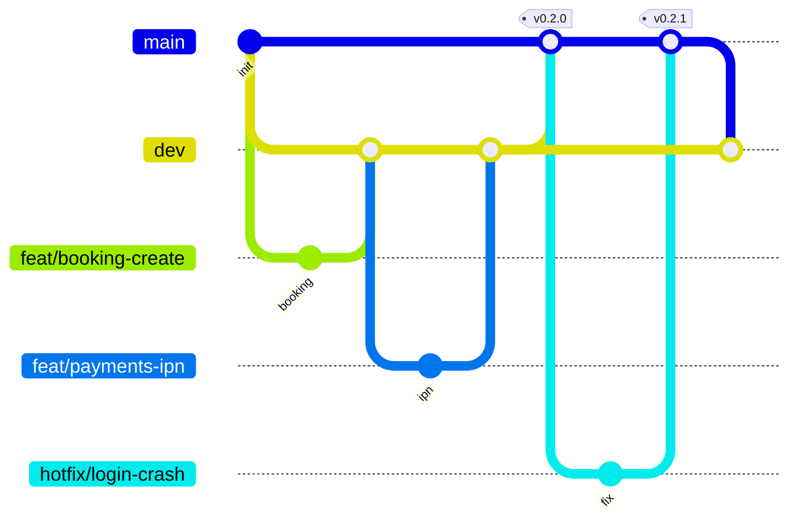

# ADR-0007: Nhánh `dev` (staging) trước `main` (production)

- Trạng thái: Đã chấp nhận
- Ngày: 2026-11-14

## Bối cảnh

Bốn người làm song song trên bốn domain. Nếu mọi nhánh tính năng merge thẳng vào `main`, các thay đổi chỉ gặp nhau lần đầu ở production: lỗi tích hợp giữa module (booking gọi payments, tracking nghe event booking...) sẽ lọt ra bản đang demo. Nhóm cần một chỗ để ghép và thử mọi thứ với nhau trước khi phát hành.

## Quyết định

Mô hình hai nhánh dài hạn (GitFlow rút gọn):

| Nhánh                        | Vai trò                                | Ai merge vào                                    | Môi trường                                                       |
| ---------------------------- | -------------------------------------- | ----------------------------------------------- | ---------------------------------------------------------------- |
| `feat/*`, `fix/*`, `chore/*` | Một tính năng / một lỗi, sống 1–3 ngày | —                                               | Máy dev                                                          |
| `dev`                        | Tích hợp: mọi tính năng gặp nhau ở đây | PR từ nhánh tính năng (CI xanh + 1 review)      | **staging** (tự deploy)                                          |
| `main`                       | Bản phát hành, luôn chạy được          | Chỉ **release PR `dev → main`** hoặc `hotfix/*` | **production** (deploy có duyệt tay)                             |
| `hotfix/*`                   | Sửa gấp lỗi trên production            | —                                               | Tách từ `main`, merge vào `main` rồi merge `main` ngược về `dev` |

Công cụ ép quy tắc:

- CI chạy trên mọi PR vào `dev` và `main`. Job **Branch policy** làm PR vào `main` thất bại nếu nhánh nguồn không phải `dev` hoặc `hotfix/*`.
- Image Docker được build cho cả `dev` (tag `dev`, `sha-…`) và `main` (`latest`, `sha-…`). CD deploy `dev` lên staging, `main` lên production. Mỗi môi trường có secret và server riêng.
- Dependabot mở PR vào `dev`.
- Branch ruleset trên GitHub (chủ repo cấu hình): cấm push thẳng và force-push vào `dev`/`main`, bắt buộc PR, CI xanh và ít nhất 1 review.

Phát hành: khi `dev` ổn định trên staging (cuối mỗi phase hoặc trước buổi demo), một người mở PR `dev → main`, ghi tóm tắt thay đổi; sau khi merge thì gắn tag `vX.Y.Z` trên `main`.

## Phương án đã loại

- **Trunk-based (chỉ `main` + feature flag):** nhanh nhất, nhưng cần feature flag và kỷ luật test cao. Nhóm sinh viên chưa có staging tách biệt nên rủi ro làm hỏng bản demo.
- **GitFlow đầy đủ (thêm `release/*`):** quá nặng cho 4 người; `dev` đã đảm nhận vai trò release candidate.

## Hệ quả

- (+) Lỗi tích hợp lộ ra trên staging, `main` luôn là bản demo được.
- (+) Lịch sử release rõ ràng (release PR + tag), dễ đưa vào báo cáo.
- (−) Thêm một bước merge. Hotfix phải nhớ merge ngược về `dev`, nếu không bản sửa sẽ bị mất ở lần phát hành sau.
