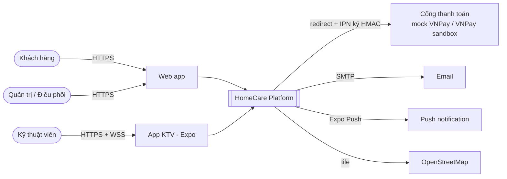
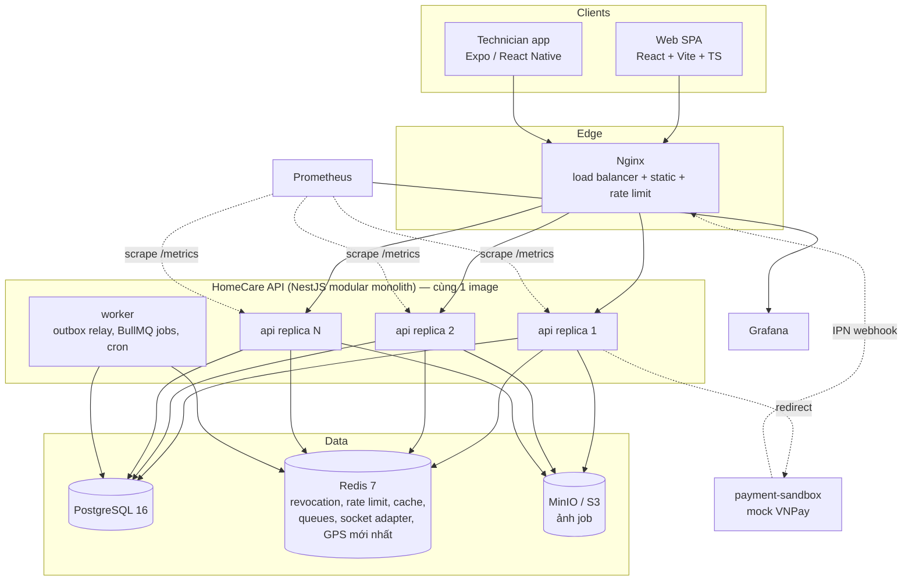
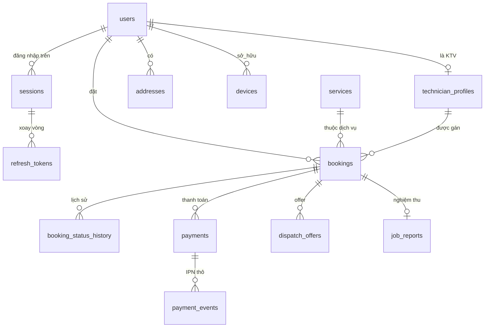
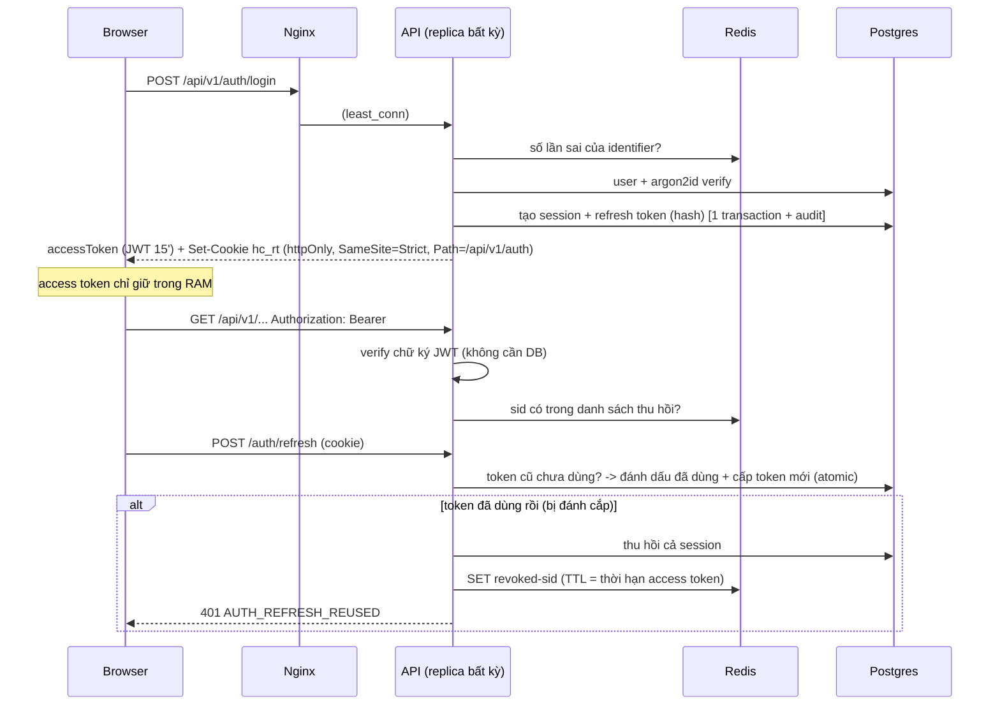
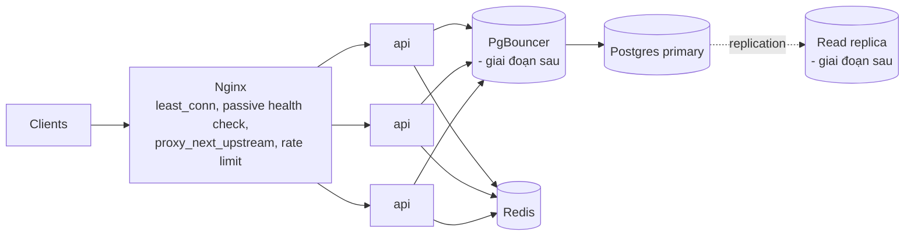
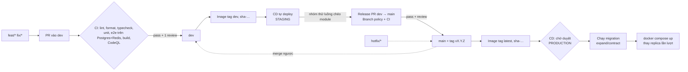

# HomeCare — Thiết kế hệ thống (System Design)

> Tài liệu kiến trúc chính của đồ án. Mọi thay đổi kiến trúc phải cập nhật file này **và** thêm một ADR trong `docs/adr/`.
> Sơ đồ viết bằng Mermaid (GitHub render trực tiếp; xuất ảnh cho báo cáo bằng [mermaid.live](https://mermaid.live)).

## 1. Bài toán

HomeCare là nền tảng đặt dịch vụ chăm sóc nhà theo yêu cầu (vệ sinh, sửa chữa, bảo trì thiết bị). Ba nhóm người dùng:

| Vai trò             | Kênh               | Việc chính                                                                        |
| ------------------- | ------------------ | --------------------------------------------------------------------------------- |
| Khách hàng          | Web (React)        | Đặt lịch, thanh toán, theo dõi kỹ thuật viên realtime, quản lý thiết bị trong nhà |
| Kỹ thuật viên (KTV) | App di động (Expo) | Nhận job, chia sẻ GPS, chụp ảnh trước/sau, hoàn tất job                           |
| Quản trị/Điều phối  | Web console        | Quản lý người dùng, điều phối, đối soát thanh toán, giám sát bản đồ realtime      |

### 1.1 Yêu cầu chức năng (MVP)

1. Đăng ký/đăng nhập, phân quyền theo vai trò, quản lý phiên trên nhiều thiết bị.
2. Danh mục dịch vụ, báo giá **do server tính**, voucher, add-on.
3. Đặt lịch theo khung giờ; booking đi qua **state machine** rõ ràng.
4. Điều phối: gán KTV phù hợp (kỹ năng, khu vực, lịch trống), offer có hạn chấp nhận.
5. Thanh toán qua cổng mô phỏng kiểu VNPay (redirect + IPN ký HMAC) hoặc tiền mặt; hoàn tiền khi hủy.
6. Theo dõi KTV realtime (vị trí, ETA, trạng thái) qua WebSocket.
7. Báo cáo hoàn thành có ảnh trước/sau (lưu object storage).
8. Thông báo in-app + email; nhắc bảo trì thiết bị định kỳ.

### 1.2 Yêu cầu phi chức năng

| Thuộc tính | Mục tiêu MVP                                              | Cách đạt                                                                             |
| ---------- | --------------------------------------------------------- | ------------------------------------------------------------------------------------ |
| Khả dụng   | 99.5% / tháng                                             | Nhiều replica API sau load balancer, health check, graceful shutdown                 |
| Độ trễ     | p95 < 300 ms cho API đọc; cập nhật vị trí đến khách < 2 s | Index đúng, Redis cho dữ liệu nóng, WebSocket                                        |
| Mở rộng    | Scale ngang API không cần sửa code                        | API stateless (JWT), state chia sẻ ở Postgres/Redis                                  |
| Toàn vẹn   | Không double-booking KTV, không trừ tiền 2 lần            | Exclusion constraint, idempotency key, IPN idempotent, optimistic locking            |
| Bảo mật    | OWASP API Top 10                                          | RBAC + kiểm tra sở hữu, zod whitelist, rate limit, audit log, refresh-token rotation |
| Quan sát   | Tìm ra lỗi từ 1 request id                                | Log JSON có request id + instance, Prometheus metrics, Grafana                       |

### 1.3 Ước lượng tải (back-of-the-envelope)

Giả định quy mô một thành phố giai đoạn đầu: 50 000 khách hàng, 500 KTV, 3 000 booking/ngày.

- **API thường:** ~20 request/booking-flow × 3 000 + duyệt app ≈ 200 000 req/ngày ≈ **2–3 req/s trung bình, ~30 req/s giờ cao điểm**.
- **GPS:** 300 KTV đang làm việc × 1 điểm / 5 s = **60 write/s** → không ghi thẳng mọi điểm vào Postgres: vị trí mới nhất ở Redis (`SET`, O(1)), lịch sử **lấy mẫu** 1 điểm/30 s ≈ 10 insert/s ≈ 860 000 dòng/ngày → partition theo ngày hoặc TTL 30 ngày.
- **WebSocket:** ~1 000 kết nối đồng thời — một replica Node.js xử lý được hàng chục nghìn; nhiều replica cần **Redis adapter** để phát sự kiện chéo.
- **Lưu trữ ảnh:** 3 000 job × 2 ảnh × 500 KB ≈ 3 GB/ngày → object storage (MinIO/S3), DB chỉ giữ object key.

Kết luận: một Postgres + một Redis đủ cho MVP; nút thắt đầu tiên khi tăng tải là **số kết nối DB** (N replica × pool) → giải pháp PgBouncer/read replica (mục 8).

## 2. Kiến trúc tổng thể

### 2.1 C4 — Context



### 2.2 C4 — Container



**Vì sao modular monolith?** 4 người, 1 học kỳ: microservices sẽ tiêu tốn thời gian vào hạ tầng (service discovery, distributed transaction, nhiều pipeline) thay vì nghiệp vụ. Modular monolith cho **ranh giới module rõ ràng như microservices** nhưng **triển khai đơn giản như monolith**, và vẫn scale ngang được. Đường tách thành microservice được mô tả ở mục 9. Chi tiết: [ADR-0001](../adr/0001-modular-monolith.md).

### 2.3 Một image — hai vai trò tiến trình

| Vai trò  | Lệnh                  | Sau LB?       | Nhiệm vụ                                                                    |
| -------- | --------------------- | ------------- | --------------------------------------------------------------------------- |
| `api`    | `node dist/main.js`   | Có, N replica | REST + WebSocket                                                            |
| `worker` | `node dist/worker.js` | Không         | Outbox relay, BullMQ (hết hạn thanh toán, timeout offer), cron nhắc bảo trì |

Tách worker giúp request của người dùng không bị chậm bởi job nền, và scale hai loại độc lập.

## 3. Module (bounded context)

```mermaid
flowchart LR
  identity[identity\nTV1]
  profile[profile\nTV1]
  catalog[catalog\nTV2]
  booking[booking\nTV2]
  dispatch[dispatch\nTV2]
  payments[payments\nTV3]
  technician[technician\nTV4]
  tracking[tracking\nTV4]
  notifications[notifications\nTV4]

  booking -->|tính giá| catalog
  booking -->|gán KTV| dispatch
  dispatch -->|lịch, kỹ năng| technician
  payments -. payment.succeeded .-> booking
  booking -. booking.status_changed .-> notifications
  booking -. booking.status_changed .-> tracking
  dispatch -. dispatch.offer_created .-> notifications
  identity -. user_registered .-> notifications
  tracking -->|ai được xem booking| booking
```

Mũi tên liền = gọi đồng bộ qua service đã export. Mũi tên đứt = domain event qua **outbox**.

### Module boundaries

1. Mỗi module nằm trong `backend/src/modules/<tên>/` và chỉ công bố API qua `index.ts`.
2. Module khác **chỉ import từ `index.ts`** — ESLint (`no-restricted-imports`) chặn import sâu.
3. `common/` và `infra/` là shared kernel, **không** được import module nghiệp vụ (ESLint chặn).
4. Mỗi module sở hữu file schema của mình trong `backend/prisma/schema/<module>.prisma`; **không truy vấn bảng của module khác** — gọi service của module đó.
5. Phụ thuộc giữa module phải là đồ thị không vòng; cần đảo chiều thì dùng event.

## 4. Dữ liệu

### 4.1 ERD rút gọn



### 4.2 Quy ước

- Khóa chính **UUID v7** (tăng theo thời gian → index B-tree không phân mảnh như UUID v4).
- Tiền: `Int` VND. Thời gian: `timestamptz`.
- Booking lưu **snapshot** địa chỉ và giá add-on lúc đặt để lịch sử không đổi khi dữ liệu gốc đổi.
- `bookings.version` cho **optimistic locking** khi nhiều tác nhân (khách hủy, KTV nhận) cập nhật cùng lúc.
- **Chống trùng lịch KTV** ở tầng DB bằng exclusion constraint GiST trên `tstzrange(scheduled_start, scheduled_end)` — đúng kể cả khi 2 replica xử lý đồng thời (code chỉ kiểm tra thì có race condition).
- Bảng ghi nhiều (`location_pings`) không có FK, id `BigInt`, lấy mẫu; dọn bằng job theo TTL.

## 5. Luồng chính

### 5.1 Đăng nhập & refresh token rotation (đã cài đặt — module identity)



Thiết kế này cho phép **API stateless** (replica nào cũng verify được JWT) nhưng vẫn **thu hồi tức thì** (logout, khóa tài khoản) nhờ Redis. Chi tiết: [ADR-0004](../adr/0004-auth-tokens.md).

### 5.2 Đặt lịch + thanh toán qua cổng (TV2 + TV3)

```mermaid
sequenceDiagram
  participant C as Khách
  participant A as API
  participant DB as Postgres
  participant G as payment-sandbox
  participant W as Worker
  C->>A: POST /bookings {serviceId, addOnIds, slot, addressId, voucher} + Idempotency-Key
  A->>DB: tính giá từ catalog (KHÔNG nhận giá từ client)
  A->>DB: INSERT booking PENDING_PAYMENT + history + outbox [1 transaction]
  A-->>C: booking
  C->>A: POST /payments {bookingId} + Idempotency-Key
  A->>DB: payment PENDING, amount = booking.total, expiresAt = +15'
  A-->>C: paymentUrl (đã ký HMAC-SHA512)
  C->>G: redirect, chọn Thành công
  G->>A: IPN (server-to-server, ký HMAC)
  A->>A: verify chữ ký, so khớp amount + txnRef
  A->>DB: SELECT ... FOR UPDATE payment; nếu đã SUCCEEDED -> trả OK (idempotent)
  A->>DB: payment SUCCEEDED + outbox payment.succeeded [1 transaction]
  G-->>C: redirect về returnUrl (chỉ để hiển thị, không đổi trạng thái)
  W->>DB: relay outbox
  W->>A: booking PENDING_PAYMENT -> PAID, bắt đầu điều phối
```

Chi tiết: [ADR-0003](../adr/0003-mock-vnpay-gateway.md).

### 5.3 Theo dõi realtime (TV4)

```mermaid
sequenceDiagram
  participant T as App KTV
  participant A1 as API replica 1
  participant R as Redis
  participant A2 as API replica 2
  participant C as Web khách
  T->>A1: WS technician.location.update {bookingId, lat, lng}
  A1->>A1: KTV có đang được gán booking này? throttle 1 điểm/3s, tốc độ < 150 km/h?
  A1->>R: SET vị trí mới nhất; mỗi 30s ghi 1 mẫu vào Postgres
  A1->>R: publish tới room booking:{id} (Socket.IO Redis adapter)
  R-->>A2: fan-out
  A2-->>C: technician.location {lat, lng, etaSeconds}
```

Khách và KTV có thể nối vào **hai replica khác nhau** — Redis adapter bảo đảm sự kiện vẫn đến nơi. Client dùng `transports: ['websocket']` nên **không cần sticky session**. Chi tiết: [ADR-0005](../adr/0005-load-balancing-realtime.md).

## 6. Chống bypass (tin server, không tin client)

| Mối đe dọa      | Ví dụ tấn công                              | Biện pháp                                                                                     |
| --------------- | ------------------------------------------- | --------------------------------------------------------------------------------------------- |
| Sửa giá         | Gửi `amount: 1000` khi thanh toán           | Client chỉ gửi ID; giá tính lại ở server từ catalog; IPN so khớp số tiền                      |
| Giả trạng thái  | Gọi API đặt booking `COMPLETED`             | Mọi chuyển trạng thái qua `booking.state.ts` kèm kiểm tra vai trò người thực hiện             |
| IDOR            | Đổi `bookingId` để xem booking người khác   | `@CurrentUser()` từ JWT; mọi truy vấn có điều kiện sở hữu; e2e test cho trường hợp bị từ chối |
| Mass assignment | Gửi thêm `role: "ADMIN"` khi đăng ký        | zod `.strict()` từ chối field lạ (có e2e test)                                                |
| Giả IPN         | Gọi thẳng webhook báo "đã thanh toán"       | Verify HMAC, so khớp số tiền + txnRef, log `payment_events`                                   |
| Gửi lại request | Double-click / mạng chập chờn tạo 2 booking | `Idempotency-Key` + bảng `idempotency_keys`                                                   |
| Giả GPS         | Dịch chuyển tức thời                        | Chỉ KTV được gán mới gửi được; gắn cờ khi tốc độ bất khả thi                                  |
| Hoàn thành giả  | Bấm "xong" khi chưa làm                     | Bắt buộc ảnh trước/sau đã upload (kiểm tra object tồn tại)                                    |
| Brute-force     | Dò mật khẩu                                 | Rate limit ở Nginx + API (Redis, dùng chung giữa replica) + khóa identifier 15' sau 5 lần sai |
| Đánh cắp token  | XSS đọc token                               | Access token chỉ ở RAM, refresh token httpOnly cookie; rotation + phát hiện tái sử dụng       |
| Leo quyền       | Khách gọi API admin                         | Guard toàn cục mặc định **bắt buộc đăng nhập**; `@Roles()` cho route đặc quyền                |

## 7. Độ tin cậy

- **Transactional outbox:** thay đổi trạng thái và event được ghi trong **cùng một transaction**; worker đọc bằng `FOR UPDATE SKIP LOCKED` (chạy nhiều worker vẫn an toàn) và giao **at-least-once** → handler phải idempotent. Tránh lỗi "đã lưu DB nhưng chưa gửi event" (dual write).
- **Idempotency:** POST tạo booking/thanh toán bắt buộc `Idempotency-Key`; IPN xử lý lặp lại vẫn cho cùng kết quả.
- **Hàng đợi (BullMQ):** retry với backoff, dead-letter; job hẹn giờ cho hết hạn thanh toán (15') và timeout offer điều phối.
- **Graceful shutdown:** `enableShutdownHooks` + `stop_grace_period` → replica bị thay thế hoàn tất request đang chạy, LB chuyển sang replica khác.
- **Health check:** `/health/live` (process) và `/health/ready` (DB + Redis) cho orchestrator/LB.

## 8. Mở rộng & Load balancing



- **Stateless API:** không lưu session trong RAM → thêm/bớt replica tự do (`docker compose ... up --scale api=5`). Nginx phân giải lại DNS `api` mỗi 10 s nên nhận replica mới không cần reload.
- **Thuật toán LB:** `least_conn` thay vì round-robin vì WebSocket là kết nối dài.
- **Retry an toàn:** `proxy_next_upstream error timeout http_502 http_503` — chỉ retry khi request chưa chạm logic nghiệp vụ.
- **State dùng chung:** rate limit và thu hồi token lưu ở Redis, nên mọi replica thấy giống nhau (có e2e test cho logout tức thì).
- **Chứng minh khi demo:** mỗi response có header `x-served-by`; log Nginx có `upstream`; Grafana vẽ request/s theo từng replica; `tests/load/auth-smoke.js` (k6) tạo tải.
- **Bước tiếp theo khi tải tăng:** PgBouncer (giới hạn kết nối), read replica cho truy vấn báo cáo, cache danh mục dịch vụ ở Redis, partition `location_pings` theo ngày.

## 9. Quan sát (observability)

- **Log:** pino JSON, mỗi dòng có `requestId` (nhận từ Nginx `X-Request-Id`), `instance` (hostname replica), `role`. Header nhạy cảm bị che.
- **Metrics:** `/metrics` (Prometheus): latency histogram theo route, metric nghiệp vụ (`auth_events_total`, sau này `bookings_created_total`, `payments_succeeded_total`). Prometheus tìm replica qua Docker DNS.
- **Dashboard:** Grafana provision sẵn "HomeCare API — overview".
- **SLO gợi ý:** 99.5% request `/api` không 5xx; p95 < 300 ms.

## 10. Triển khai & CI/CD



- Nhánh: `dev` là nơi tích hợp và chạy staging; `main` chỉ nhận release PR từ `dev` hoặc `hotfix/*` (CI chặn các trường hợp khác). Chi tiết: [ADR-0007](../adr/0007-branching-strategy.md).
- Môi trường: `local` (pnpm dev + infra) → `stack` (docker compose giống production trên 1 máy) → `staging` (nhánh `dev`, tự deploy) → `production` (nhánh `main`, CD qua SSH, có duyệt tay). Mỗi môi trường có server và secret riêng.
- **Migration an toàn khi rolling update:** vì phiên bản cũ vẫn chạy trong lúc deploy, migration phải tương thích ngược (thêm cột trước, đổi code, xóa cột ở release sau).
- Secrets chỉ nằm trong GitHub Environments; app từ chối khởi động nếu dùng secret dev ở production.

## 11. Đánh đổi & hướng phát triển

| Quyết định                 | Được                                            | Mất                             | Khi nào xem lại                                   |
| -------------------------- | ----------------------------------------------- | ------------------------------- | ------------------------------------------------- |
| Modular monolith           | Phát triển nhanh, transaction ACID giữa module  | Không scale riêng từng module   | Khi một module (tracking) cần tài nguyên khác hẳn |
| JWT + Redis denylist       | Stateless, thu hồi tức thì                      | Phụ thuộc Redis cho mọi request | Redis Sentinel/Cluster khi cần HA                 |
| Outbox thay message broker | Không thêm hạ tầng                              | Độ trễ poll ~1 s                | Chuyển sang Kafka/RabbitMQ khi tách service       |
| Mock VNPay                 | Demo được mọi kịch bản (thất bại, hủy, IPN trễ) | Không phải tiền thật            | Bật adapter VNPay sandbox khi có merchant         |

**Lộ trình tách microservice:** module `tracking` là ứng viên đầu tiên (tải ghi cao, giao thức WebSocket riêng). Nhờ ranh giới module + event qua outbox, tách bằng cách: (1) chuyển outbox relay sang publish lên broker, (2) chuyển bảng `location_pings` sang DB riêng, (3) Nginx route `/socket.io` sang service mới.
